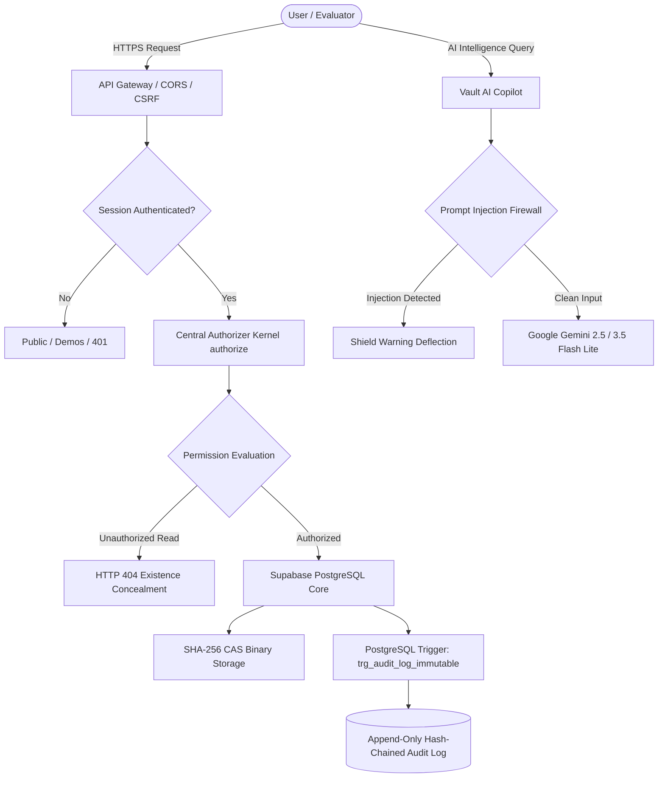

# TrustVault System Architecture Specification

---

## 1. Zero-Trust Architectural Philosophy

TrustVault is engineered around the principle of **Zero-Trust**: *never trust, always verify, deny by default*. Traditional document storage platforms rely on discretionary access controls or frontend-level gates that leak document metadata and permit unauthorized enumeration (IDOR). TrustVault enforces mathematical boundaries at the database kernel and API gateway levels.



---

## 2. The Five Immutable Security Invariants

### Invariant 1: Central Authorizer Kernel (`authorize()`)
Every document action (`read`, `download`, `edit`, `share`, `delete`, `recover`) routes through a single centralized authorization kernel.
- **Deny by default**: Unless an active, unexpired, unrevoked grant or ownership relation explicitly exists in the database, the operation is denied.
- **Zero Role Bypass**: Administrative status alone NEVER grants implicit read access to user documents. Administrators are system auditors, not super-users with file access (Principle of Least Privilege).

### Invariant 2: Existence Concealment (Mathematical IDOR Defeat)
When an unauthorized user attempts to read, download, or query metadata for a document ID they lack permissions for:
$$\text{Response} = \text{HTTP 404 Not Found}$$
- Returning `403 Forbidden` leaks the existence of confidential files.
- By returning an identical `404 Not Found` response with identical headers and timing, attackers cannot determine whether a secret document exists at a probed UUID.

### Invariant 3: Content-Addressable Storage (CAS)
- Binary payloads are hashed using SHA-256 upon reception.
- The storage key is cryptographically tied to the payload hash.
- Identical documents automatically deduplicate at the storage layer while maintaining segregated ownership records in PostgreSQL.
- Gateway inspection checks binary magic bytes (e.g. `%PDF` header), immediately rejecting disguised executables (`4D 5A` MZ PE or `7F 45 4C 46` ELF).

### Invariant 4: Append-Only Cryptographic Audit Log
Every state-changing event and anomaly is recorded in `audit_log`:
$$\text{CurrentHash}_n = \text{SHA-256}(\text{PreviousHash}_{n-1} + \text{canonicalJSON}(E_n))$$
- Chained continuously from Genesis hash `00000000000000000000000000000000`.
- PostgreSQL Database Trigger `trg_audit_log_immutable` executes on `BEFORE UPDATE OR DELETE`:
  ```sql
  CREATE OR REPLACE FUNCTION fn_audit_log_immutable()
  RETURNS TRIGGER AS $$
  BEGIN
      RAISE EXCEPTION 'TrustVault Invariant Violation: audit_log table is append-only. UPDATE and DELETE are prohibited.'
      USING ERRCODE = '23505';
  END;
  $$ LANGUAGE plpgsql;
  ```

### Invariant 5: Agentic AI Firewall & Prompt Injection Defense
TrustVault embeds an Agentic Security Copilot powered by Google Gemini 2.5 / 3.5 Flash Lite:
- **Pre-flight Firewall**: Scans all inbound prompts for instruction overrides, system prompt exfiltration probes, DAN jailbreaks, roleplay bypasses, and SQL injection payloads.
- **Authorization Scoping**: The Copilot only has access to documents for which the authenticated user holds valid grants. It cannot be coerced into reading unauthorized files.
- **Safe Fallback**: If an external API key is unconfigured or rate-limited, the system falls back to a deterministic local security engine without interrupting service.

---

## 3. Database Schema & Synchronization

TrustVault utilizes a relational PostgreSQL database schema synchronized with **Supabase Project `hybpqldwblpxluvsqazz`**:
- `users`: User profiles with Argon2id password hashes (`m=65536, t=3, p=4`), failed login counters, and lockout timestamps.
- `documents`: Document records containing ownership, title, category, and version pointers.
- `document_versions`: Version history linking documents to their SHA-256 CAS storage keys.
- `document_grants`: Access grants (`read` or `edit`) with optional expiration timestamps.
- `download_tokens`: Single-use 60-second download tokens with cryptographic consumption tracking.
- `audit_log`: Cryptographically linked, immutable event ledger.
